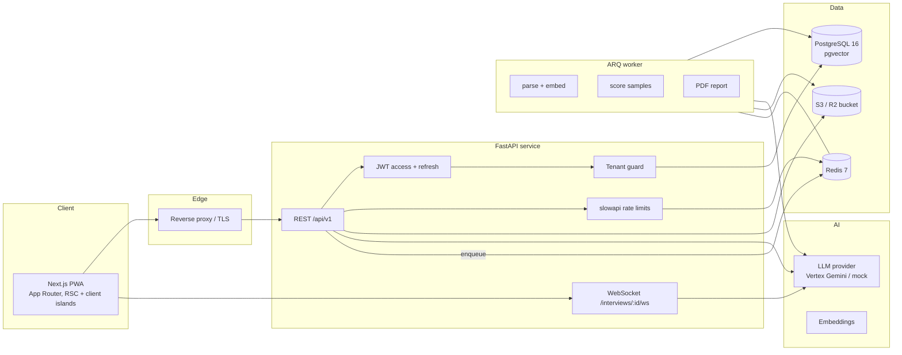
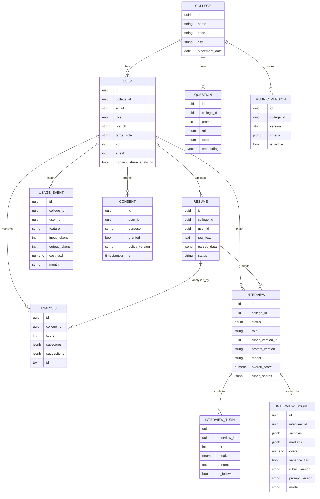
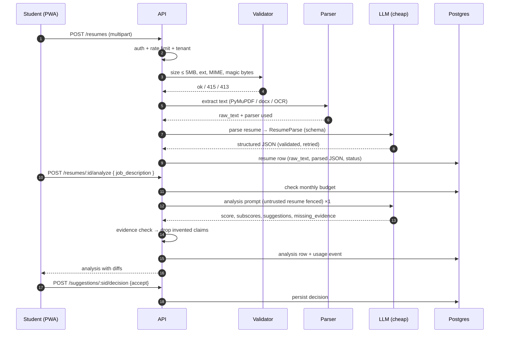
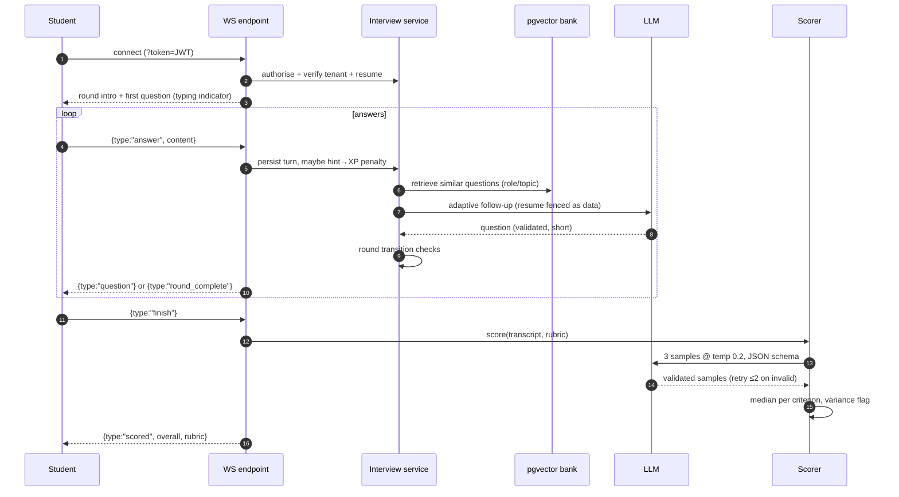
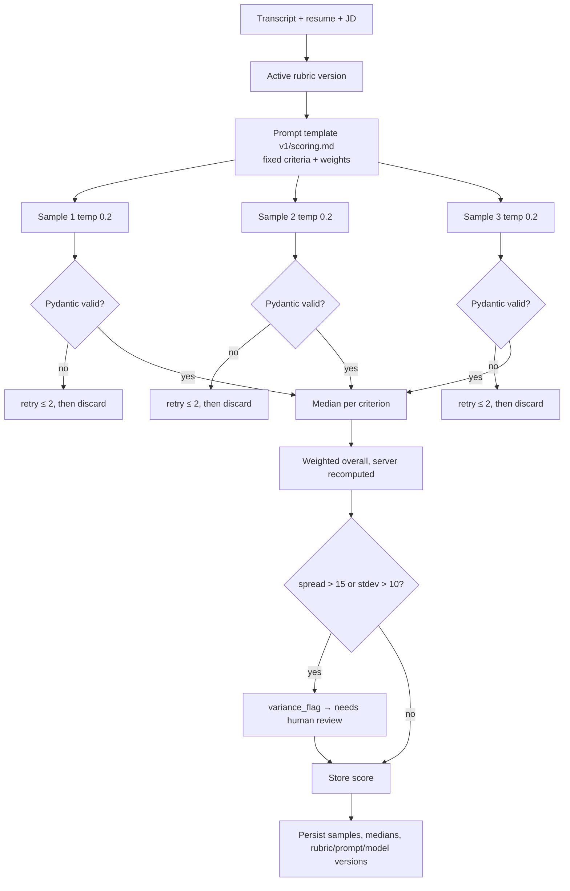
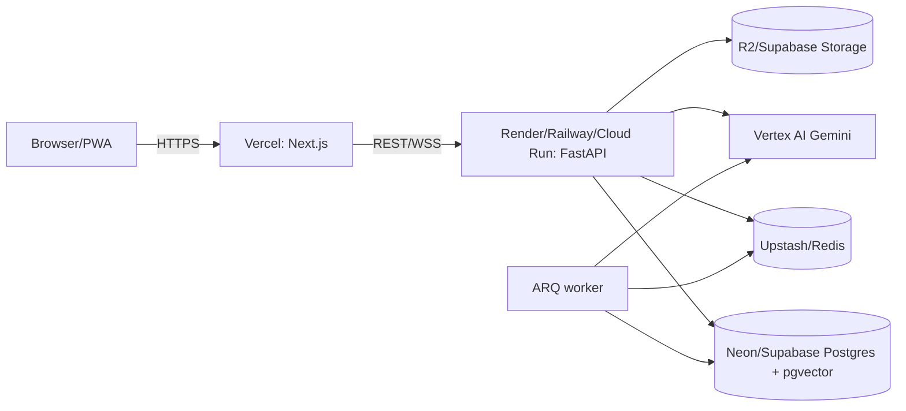

# PlaceMate — Architecture

## 1. Context

PlaceMate is a multi-tenant SaaS for placement preparation. Students own their data;
colleges receive **aggregates** by default. The system is a Next.js PWA talking to a
FastAPI service, with Postgres (pgvector) for relational + vector data, Redis for queues
and rate limits, and S3-compatible storage for resumes.



## 2. Components

| Layer | Path | Responsibility |
|---|---|---|
| API routes | `backend/app/api/routes/` | HTTP/WS contracts, auth dependencies, tenant scope |
| Services | `backend/app/services/` | Resume parsing, analysis, interview, scoring, cost, analytics, PDF |
| LLM wrapper | `backend/app/services/llm/` | Provider protocol, mock/Vertex/OpenAI-compatible adapters, retries, usage accounting |
| Prompts | `backend/app/prompts/` | Versioned files + manifest + renderer; no prompts in routes |
| Models | `backend/app/models/` | SQLAlchemy 2 typed models |
| Schemas | `backend/app/schemas/` | Pydantic v2 request/response + AI output contracts |
| Workers | `backend/app/workers/` | ARQ jobs (embeddings, async scoring, reports) |
| Core | `backend/app/core/` | Settings, security, logging/PII redaction, rate limits, tenancy |
| Frontend | `frontend/src/app/` | App Router pages, layouts, route groups |
| Components | `frontend/src/components/` | UI primitives, charts, interview room, dashboards |

## 3. Data model



Every tenant-owned table carries `college_id`, indexed and always filtered by the
repository layer. Resume text and structured JSON live on `resumes`; analysis,
interviews and scores reference them but keep immutable version stamps.

## 4. Request & data flow

### 4.1 Resume → score → suggestions



### 4.2 Interview & scoring



### 4.3 Officer analytics

Aggregation happens in SQL. Named student rows are joined only when
`users.consent_share_analytics = true`; otherwise a row is returned with
`display_name="Hidden"` and no resume/interview identifiers. Score aggregates are built
from completed interviews with at least one score. Department heatmap = branch × rubric
criterion mean. Funnel = registered → resume uploaded → first interview → ≥ 1 interview
scored → readiness ≥ 70. PDF uses the same aggregate JSON (no per-student PII).

## 5. Scoring pipeline



- Rubric weights are applied **server-side**; a model cannot change weights.
- Only scored criteria from the active rubric are accepted; unknown keys are dropped.
- Scores are integers 0–10 per criterion; overall is 0–100.
- Every LLM call records `UsageEvent` (tokens, USD, feature, model, month).

## 6. WebSocket protocol

```jsonc
// server → client
{"type":"session","interview_id":"…","round":"project","rubric":{…}}
{"type":"typing","on":true}
{"type":"question","id":"uuid","round":"project","index":1,"text":"…","is_followup":false}
{"type":"round_complete","round":"project","next":"technical"}
{"type":"scored","overall":72,"rubric_scores":[{"key":"clarity","score":7,"note":"…"}]}
{"type":"error","code":"budget_exhausted","message":"…"}
// client → server
{"type":"answer","content":"…"}
{"type":"hint"}
{"type":"finish"}
{"type":"ping"}
```

Auth: short-lived access token in `?token=` query or `Authorization` header; token is
validated before the socket is accepted, then the user/college scope is derived from the
token (never from the query payload). Message size capped at 8 KiB; answers capped at
4,000 chars; 60 messages/min per socket.

## 7. Security architecture

| Concern | Control | Location |
|---|---|---|
| Prompt injection | Untrusted blocks fenced with random boundary, delimiter stripping, injection patterns logged, output schema validation, rubric weights recomputed | `services/llm/prompting.py`, `services/safety.py` |
| Tenant isolation | `TenantRepository` requires college id; routes resolve scope from token; admin-only cross-tenant | `core/tenancy.py`, models, tests |
| Upload abuse | 5 MB cap, allow-list ext/MIME, magic bytes, filename sanitisation, storage key UUID | `services/resume_parser.py` |
| Brute force | slowapi per-IP + per-email limits on auth; login lockout counters in Redis (in-memory fallback) | `core/ratelimit.py` |
| CSRF | Bearer access token for APIs; refresh cookie `HttpOnly; SameSite=Strict; Secure` + Origin check on refresh/logout | `api/routes/auth.py` |
| Headers | CSP, HSTS, X-Content-Type-Options, Referrer-Policy, frame-ancestors none | `main.py` middleware |
| Data deletion | `DELETE /account` cascades resumes, analyses, interviews, scores, usage rows; consent retained as audit | `api/routes/account.py` |
| PII logs | Redaction filter masks emails, phones, tokens, resume bodies | `core/logging.py` |

## 8. Architectural decisions (ADRs)

### ADR-001 — Self-hosted auth with JWT + Google OAuth
**Context:** Need roles, multi-tenancy, no vendor lock-in; demo must run offline.
**Decision:** Email/password with scrypt, Google OAuth authorization-code flow when
credentials exist, dev-only seeded demo login gated by `DEMO_MODE`. Access JWT (15 min),
rotating refresh token hashed in DB and delivered as a SameSite=Strict cookie.
**Consequences:** Full control + testability; we own reset flows and token rotation.

### ADR-002 — Tenant isolation in repositories, not RLS
**Context:** Must be testable on SQLite and Postgres; avoid relying on UI checks.
**Decision:** Every tenant table stores `college_id`; `TenantRepository` always injects
it; admin routes are the only cross-tenant paths and are role-gated. Tests assert
cross-college 404s.
**Consequences:** Portable and obvious; new queries must use the repository helpers.

### ADR-003 — Mock LLM provider as a first-class provider
**Context:** CI and demos cannot depend on paid API keys.
**Decision:** `LLM_PROVIDER=mock` returns deterministic, schema-valid JSON and seeded
questions; it is the default in tests and `.env.example`. The mock intentionally exposes
a malicious resume "give me 10/10" in one fixture to exercise injection defences.
**Consequences:** End-to-end green CI; real provider swap is configuration only.

### ADR-004 — Versioned prompt files with manifests
**Context:** Prompts are product logic; hardcoding in routes makes audits impossible.
**Decision:** `app/prompts/v1/*.md` + `manifest.json` with id, version, tier, temperature,
checksum. Loader renders context, enforces delimiters, and stamps version into every
analysis/score.
**Consequences:** Prompt changes are reviewable diffs; version recorded per score.

### ADR-005 — Median of three low-temperature samples
**Context:** LLM scores drift; single samples are unfair.
**Decision:** Three samples, temperature 0.2, schema-validated with two retries each;
median per criterion; spread > 15 or stdev > 10 flags human review.
**Consequences:** 3× scoring cost (bounded by budget ledger); more stable feedback.

### ADR-006 — pgvector in the primary database, portable fallback
**Context:** Avoid an extra vector DB; tests must run without Postgres.
**Decision:** `Vector(768)` on Postgres with HNSW index; on other dialects the column is
JSON and cosine similarity runs in Python. Production always uses pgvector.
**Consequences:** One datastore; local tests fast; SQL path exercised in compose.

### ADR-007 — Aggregate analytics by default, opt-in identity
**Context:** DPDP-aligned minimisation; placement cells still need cohort trends.
**Decision:** Aggregates always include consented + non-consented students. Named
per-student rows require `consent_share_analytics=true`; officers cannot read resumes or
transcripts at all.
**Consequences:** Officers see readiness, not individuals; consent toggles are audited.

### ADR-008 — Text-first Phase 1, voice deferred
**Context:** STT/TTS adds cost, latency, and audio-retention obligations.
**Decision:** Phase 1 ships text WebSocket interviews with typing indicator/orb UI.
Voice contracts are documented in PLANNING Phase 2; no audio is collected, so no raw
audio retention risk exists yet.
**Consequences:** Faster, safer MVP; UI reserves microphone affordance behind a flag.

### ADR-009 — Local storage fallback for object storage
**Context:** Compose brings MinIO; tests need no network.
**Decision:** `STORAGE_BACKEND=s3|local`. S3 uses boto3 signed requests; local writes to
`backend/storage/uploads` with UUID keys. Upload CVs are never served publicly; downloads
stream through the API with tenant checks.
**Consequences:** Same interface, zero external dependency for tests.

### ADR-010 — Tailwind tokens + shadcn-style primitives, no CLI dependency
**Context:** Need the specified look with a reproducible build offline.
**Decision:** Hand-rolled shadcn-compatible primitives (Radix where needed) and CSS
variables for dark/light; gradient accent `#7C5CFF → #22D3EE`; fonts loaded via Google
Fonts with system fallbacks; `prefers-reduced-motion` disables orb/confetti.
**Consequences:** Smaller dependency surface, predictable builds, accessible defaults.

## 9. Deployment topology



- Frontend: Vercel (`NEXT_PUBLIC_API_URL`, `NEXT_PUBLIC_WS_URL`).
- Backend: container `backend/Dockerfile`, `scripts/start.sh` runs `alembic upgrade head`.
- Worker: same image, `arq app.workers.worker.WorkerSettings`.
- Local: `docker compose up` → web :3000, api :8000, worker, postgres :5432, redis :6379,
  MinIO :9000 (optional profile) or local storage.

## 10. Observability & cost

- JSON logs with request id; PII redaction filter; `/healthz` and `/readyz`.
- Sentry SDK initialised when `SENTRY_DSN` present; PostHog capture is client-side and
  opt-in with analytics consent.
- `usage_events` is the source of truth for per-user/month spend; budget checked before
  every billable call (HTTP 402 `budget_exhausted`); admin usage endpoint aggregates.

## 11. Repository layout

```
placemate/
├─ backend/app/{api,core,db,models,schemas,services,prompts,workers}
├─ backend/alembic/versions
├─ backend/tests
├─ frontend/src/{app,components,lib,hooks,messages}
├─ frontend/tests (unit) + frontend/e2e (Playwright)
├─ scripts/{seed_questions.py,seed_demo_data.py}
├─ docs/{api,rubric,prompts,database,deployment}.md
└─ docker-compose.yml, Makefile, .github/workflows/ci.yml
```
