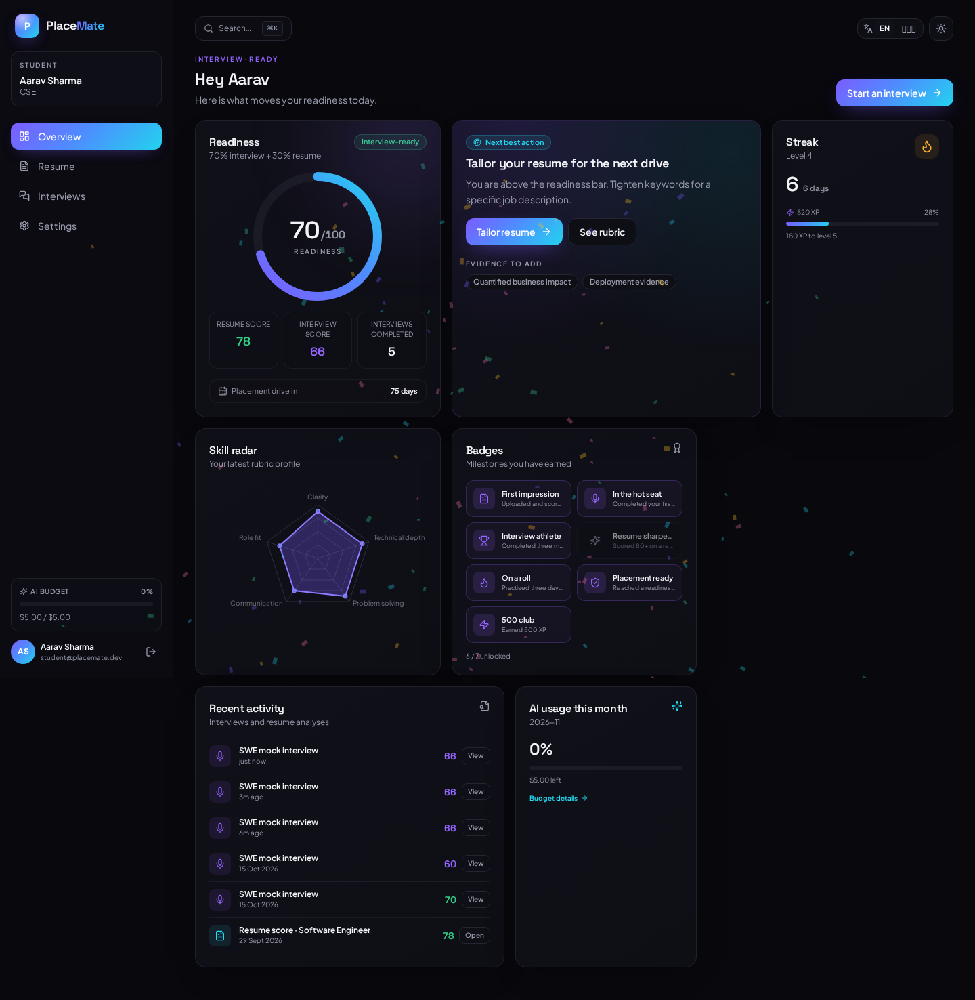
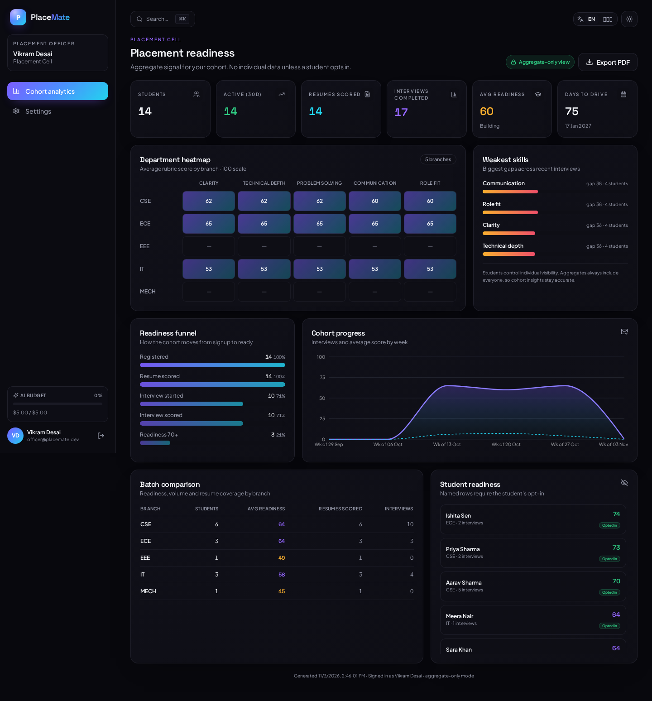
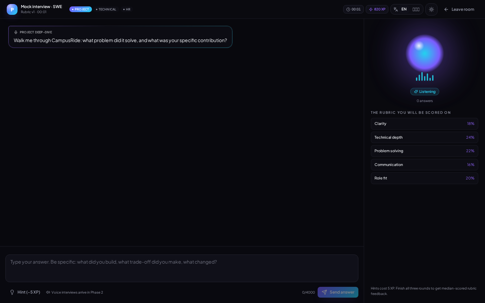
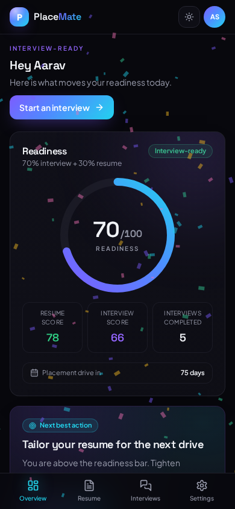

# PlaceMate

PlaceMate is an AI placement-preparation platform for students and college placement
cells. A student uploads a resume, gets an honest score with job-tailored edits, then
rehearses a three-round mock interview grounded in their **own** projects. Every
interview is scored against a rubric the student can see before starting.

Officers get aggregate-only cohort readiness, with named student rows only when the
student has explicitly opted in. Admins manage colleges, the question bank and rubric
versions.

**Phase 1 is text-only and complete. Phase 2 (voice, regional language interviews,
branch tracks, coding/aptitude, GD) is planned, not built.** See [PLANNING.md](PLANNING.md).

## Screenshots


*Student readiness, next-best-action, skill radar, streak and history.*


*Aggregate-only cohort heatmap, funnel and PDF export.*


*Full-screen text interview with a visible rubric and animated orb.*


*Mobile-first dashboard with thumb-reachable bottom navigation.*

## What works

| Area | Phase 1 behaviour |
| --- | --- |
| Auth | Email/password (scrypt), rotating refresh cookie, 15-minute access token, Google OAuth scaffold, demo login gated by `DEMO_MODE` |
| Tenancy | Every query goes through `TenantRepository` filtered by `college_id`; cross-tenant probes return 404 |
| Resume | PDF/DOCX up to 5 MB with MIME + magic-byte checks, PyMuPDF/docx parsing, OCR fallback, structured JSON |
| Analysis | Score + truthful before/after suggestions with accept/reject; missing evidence is flagged, never fabricated; prompt-injection guards |
| Interview | WebSocket text interview in project/technical/HR rounds, resume-grounded follow-ups, pgvector question retrieval, hints at an XP cost |
| Scoring | Visible versioned rubric, Pydantic-validated JSON, three samples at temperature 0.2, median per criterion, variance flag, version stamps |
| Student UX | Readiness ring, radar, streak/XP/badges/confetti, next-best-action, history, budget meter, PWA |
| Officer | Department heatmap, readiness funnel, weakest skills, cohort trend, batch table, consent-gated names, one-click PDF |
| Admin | Colleges, question bank CRUD, rubric versions and activation |
| Cost | Per-call token/cost ledger, monthly summary, per-user budget enforcement |
| Safety | Rate limits, strict CORS, security headers, CSRF origin checks, PII-redacted structured logs |

## Stack

- **Web:** Next.js 15 App Router, TypeScript, Tailwind, Radix/shadcn-style primitives,
  Framer Motion, Recharts, TanStack Query, Zustand, next-intl, PWA.
- **API:** Python 3.12, FastAPI, Pydantic v2, SQLAlchemy 2, Alembic, ARQ + Redis,
  slowapi, WebSockets.
- **Data:** PostgreSQL 16 + pgvector, Redis, S3-compatible object storage (MinIO locally).
- **AI:** provider-agnostic wrapper (`mock`, Vertex Gemini, Gemini API, OpenAI-compatible),
  versioned prompt files, JSON-schema validation, embeddings.

## Quickstart (Docker)

Prerequisites: Docker with Compose v2, and `make` (optional).

```bash
cd placemate
cp .env.example .env          # placeholders only; compose works as-is
make dev                      # docker compose up --build
```

The API waits for Postgres/Redis/MinIO, runs `alembic upgrade head`, seeds the
question bank and demo data, then starts. The web app starts on
<http://localhost:3000>; API docs are at <http://localhost:8000/docs>.

Demo accounts (all use password `Demo@1234`, seeded only when `DEMO_MODE=true`):

| Role | Email | Lands on |
| --- | --- | --- |
| Student | `student@placemate.dev` | `/dashboard` |
| Officer | `officer@placemate.dev` | `/officer` |
| Admin | `admin@placemate.dev` | `/admin` |

The login page also has one-click demo buttons. Demo mode is not a production auth
mechanism; disable it with `DEMO_MODE=false` and `NEXT_PUBLIC_DEMO_MODE=false`.

### Local (no Docker)

```bash
make install
make migrate                  # needs DATABASE_URL + Postgres; see docs/deployment.md
make seed
make dev-local                # API :8000 + web :3000
```

SQLite is supported for tests and offline demos:

```bash
cd backend
DATABASE_URL=sqlite:///./placemate.db PYTHONPATH=. ../.venv/bin/alembic upgrade head
DATABASE_URL=sqlite:///./placemate.db PYTHONPATH=. ../.venv/bin/python ../scripts/seed_demo_data.py
DATABASE_URL=sqlite:///./placemate.db LLM_PROVIDER=mock STORAGE_BACKEND=local \
  PYTHONPATH=. ../.venv/bin/uvicorn app.main:app --port 8000
```

## Tests and quality gates

```bash
make test          # pytest (29) + Vitest
make lint          # ruff + format check + mypy + eslint + prettier check
make typecheck     # tsc --noEmit
make test-e2e      # Playwright full interview flow (servers must be running)
```

Playwright exercises the real flow: demo student sign-in → interview list → new
interview → three rounds over WebSocket → scored overlay → split feedback.
`docker-compose up` is the deployment path; the CI workflow runs backend, frontend
and E2E jobs with the mock provider and SQLite.

## Repository map

```
placemate/
├── backend/app/
│   ├── api/routes/       auth, resumes, interviews (+WS), dashboard, officer, admin, account
│   ├── core/             config, security, tenancy, rate limits, redacted logging
│   ├── models/           SQLAlchemy 2 models
│   ├── schemas/          Pydantic v2 request/response + AI output schemas
│   ├── services/         parser, storage, LLM providers, scoring, analytics, PDF
│   ├── prompts/v1/       versioned prompt markdown, loaded by checksum
│   └── workers/          ARQ worker (retention/cleanup jobs)
├── frontend/src/
│   ├── app/              landing, auth, onboarding, dashboard, interview, officer, admin
│   ├── components/       app shell, charts, bento cards, UI primitives
│   └── lib/              API client, auth store, types, design tokens
├── scripts/              question bank + demo data (idempotent)
├── docs/                 API, rubric, prompts, database, deployment
└── docker-compose.yml    postgres(pgvector), redis, minio, api, worker, web
```

## Documentation

- [ARCHITECTURE.md](ARCHITECTURE.md) — components, data flow, decisions
- [PLANNING.md](PLANNING.md) — phases, milestones, risks, metrics
- [WORKING.md](WORKING.md) — every flow end-to-end, including scoring
- [SECURITY.md](SECURITY.md) — threat model, controls, DPDP, disclosure
- [docs/api.md](docs/api.md) — REST + WebSocket contract
- [docs/rubric.md](docs/rubric.md), [docs/prompts.md](docs/prompts.md)
- [docs/database.md](docs/database.md), [docs/deployment.md](docs/deployment.md)
- [CONTRIBUTING.md](CONTRIBUTING.md), [CHANGELOG.md](CHANGELOG.md)

## Design notes

Dark-first with a light toggle, violet→cyan gradient accent, bento layout, rounded-2xl
cards, Plus Jakarta Sans for body and Space Grotesk for numerals/headings. Motion is
disabled with `prefers-reduced-motion`; charts have text summaries; all controls are
keyboard reachable. The command palette opens with `⌘K`/`Ctrl+K`.

## Known limitations (Phase 1)

- Text interviews only; no audio is collected or stored.
- Resume parsing and scoring run inline; ARQ is wired for scheduled retention jobs.
  Moving them to the queue is a Phase 2 scale task and would not change the API contract.
- Google OAuth requires credentials and a public callback URL; demo/password login is
  the offline path.
- Postgres + pgvector is the production target. SQLite uses a portable embedding
  column and Python cosine similarity for tests.
- Email verification and password reset are not part of Phase 1.

## License

MIT — see [LICENSE](LICENSE).
